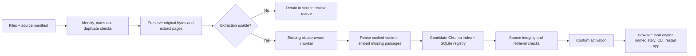

# Adding and updating payment guidelines

The new local intake pipeline accepts **Markdown and text-readable PDFs**. It builds a separate corpus release, generates missing embeddings and validates the index before you activate it. The current corpus remains selected until activation. The first real expansion imports eight RBI core payments directions using official HTML converted to Markdown. Start with [the beginner walkthrough](ADDING_DOCUMENTS_QUICKSTART.md), which uses that actual batch.

## Flow



The **Add documents** screen now wraps this pipeline for new sources. It creates the manifest from your form, previews extraction, runs build as a local job, then switches the running engine after validated activation. Rollback is available for the current activation. Prepared releases survive restart; in-progress job records and an unprepared upload selection do not. The command line remains available for batches and reviewed snapshot replacements. There is no website crawler or background source scheduler. See [the browser walkthrough](ADDING_DOCUMENTS_QUICKSTART.md).

## First intake

1. Create `inbox/` in the project. Save acquired original documents there. For RBI, start with the priorities in [the source map](RBI_PAYMENTS_SOURCE_MAP.md), download the complete official source and check the body/version before registering it.
2. Copy [intake.example.json](examples/intake.example.json) to `inbox/intake.json`. Edit it to match the file actually acquired. The example is a template, not proof that its PDF has been downloaded. `file` resolves relative to the manifest. Use the actual acquisition date and verified source dates; omit an unknown issue date.
3. From the project PowerShell terminal run:

```powershell
.\ingest.cmd prepare --manifest inbox\intake.json --release payments-20261009
.\ingest.cmd status --release payments-20261009
.\ingest.cmd build --release payments-20261009
```

Ollama must be running for `build`. The embedding model already configured in the app is used. Inspect `data/releases/payments-20261009/intake_state.json`, `embedding_build.json` and `validation.json`. Review the original files, flagged pages and candidate evidence before publication. You can preview the candidate without changing the default:

```powershell
.\.venv\Scripts\python.exe app.py serve --port 8767 --config data\releases\payments-20261009\candidate_config.json
```

Open `http://127.0.0.1:8767`. Check the new topic in the library, run a source-backed question, inspect its cited pages and try a summary. These checks establish usability, not expert correctness. Stop this preview using Ctrl+C when finished.

4. Stop the regular app using Ctrl+C, activate, then restart:

```powershell
.\ingest.cmd activate --release payments-20261009
.\run.cmd
```

Activation changes the configuration pointer atomically. It does not hot-reload a running server. The previous corpus and configuration are retained. If needed, stop the app and run:

```powershell
.\ingest.cmd rollback --release payments-20261009
.\run.cmd
```

Rollback refuses to overwrite a configuration that has since changed. Roll back the most recently active release first.

## What the manifest means

| Field | Purpose |
|---|---|
| `id` | Stable, unique identity for this source snapshot. Never recycle it for changed content. |
| `file`, `title`, `reference` | Local original, readable title and official reference. |
| `issuer`, `document_type` | Distinguish RBI directions, NPCI circulars and other source types. These are shown with evidence and included in generation context. |
| `applicability` | Optional entity labels with an exact source quote and page. Used as research context, not a hard legal filter. See [topic research](TOPIC_RESEARCH.md). |
| `products` | Explicit product/topic memberships used by the existing Product filter. Add UPI only where its applicability is supported; do not label every RBI document UPI. |
| `source_url`, `retrieved_on` | Official HTTPS source and actual local acquisition date. The pipeline does not fetch or verify the website. |
| `issue_date`, `updated_on` | Optional ISO dates. Update date is not effective date. Unknown dates remain unknown. |
| `source_notes` | Optional source limitations shown in the reader and included with adaptive answer warnings. |
| `allow_partial` | Optional boolean, default false. Explicitly accepts thin/empty pages for indexing after review; warnings and missing-page records remain. |
| `revision_of`, `expected_previous_sha256` | Explicit local snapshot replacement, with a matching hash from the previous index record. Not a legal supersession claim. |

User-supplied metadata remains labelled unverified. Precise regulated-entity applicability, effective dates and amendment relationships still need source-supported review. The V1 filter uses products/topics; it does not yet offer a dedicated issuer or regulated-entity filter.

## Pages, chunks and embeddings

PDFs retain physical page numbers and original bytes. `pypdf` extracts text; scanned pages need a separate OCR/review step. No OCR is invented. A page with fewer than 15 whitespace-separated words is flagged as thin. By default any thin/empty page quarantines that new document. This is a conservative heuristic: it can flag legitimate covers and can miss noisy extraction with many words.

Markdown can contain sequential `<!-- Page 1 -->` markers. Duplicate/skipped markers and text before the first marker are rejected to avoid silently losing content. Without markers, the document becomes one **logical Markdown page**, and original PDF pagination remains unverified. Markers alone do not verify correspondence with the PDF.

The existing `clauses-v1` chunker stays unchanged: roughly 220-word windows, 35-word overlap for long blocks, heading/clause boundaries, document/page ownership and adjacency links. Heading detection is heuristic and still needs RBI-specific evaluation.

The embedding cache keys the **exact title + section heading + passage text**, embedding model name and installed model digest. Unchanged inputs reuse vectors; new/changed inputs are embedded automatically. A changed embedding model requires new vectors. Changing only the answer-generation model does **not** require re-embedding.

Each release rebuilds a complete physical Chroma collection and SQLite metadata snapshot using those cached/new vectors. This is incremental embedding computation, **not** an in-place Chroma row update. It uses extra disk space and index-build time to preserve a recoverable old release.

## Updates, failures and publication checks

- Repeating an identical manifest against an already active intake is a no-op. Conflicting IDs and identical bytes under a new identity are rejected.
- For an amended document, use a new ID and the previous snapshot's hash. The old snapshot remains readable but is marked `archived_snapshot` and excluded from retrieval. This policy favours current research and does not provide historical effective-rule reconstruction. Reviewed relationships to the older ID are not automatically transferred.
- Some legacy records lack `source_sha256` or `markdown_sha256`. Their replacement requires a separately reviewed provenance repair first; the pipeline will not guess a prior hash. Metadata-only corrections should use the existing review process where supported, rather than registering identical bytes as a new document.
- A replacement with quarantined extraction is rejected so it cannot remove a usable prior snapshot. Review or repair it first.
- Failed embedding runs leave the active app untouched. Fix Ollama/model availability and rerun `build`; cached completed batches are reused.
- Changed candidate files, embedding digests, live config or live review inputs block activation. Prepare a fresh release when inputs change; do not edit a prepared candidate in place.
- Source hashes, unique IDs/page identities, vector counts, model digest, chunk ownership and a title-based keyword retrieval smoke check for each new searchable document are checked. These do not establish semantic retrieval quality, complete extraction or answer accuracy. Run the RAG evaluation suite and review representative new-source questions before wider use.

New releases and inbox files are Git-ignored by default. They may contain internal documents. The existing shared NPCI snapshot is unchanged. Share a reviewed corpus release explicitly if colleagues need it; generated Chroma files should be rebuilt locally. No automatic pruning is implemented.
