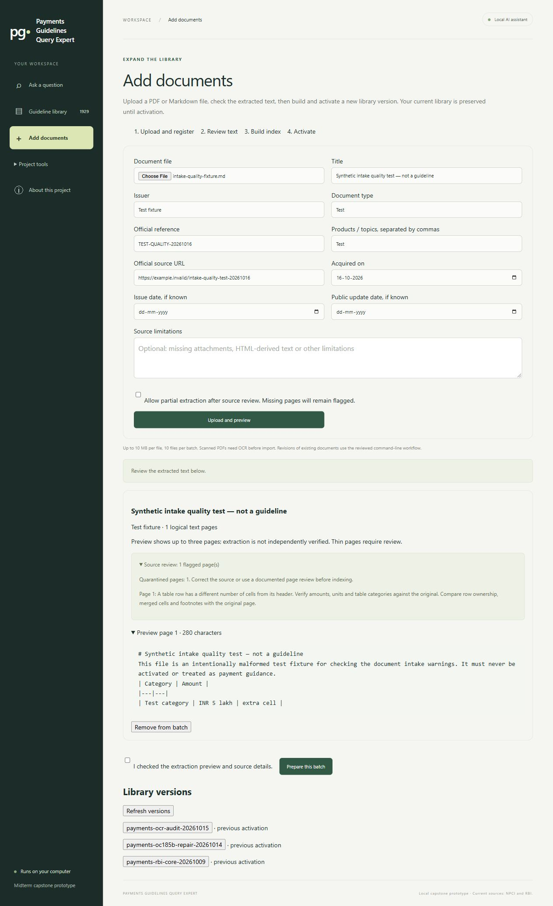

# Intake, contextual retrieval and structured synthesis

The objective is a question-focused answer supported by reliable sources. Internal evidence records are not the user-facing response. A question about a limit should receive the supported limit and its qualifications; a comparison should explain the relevant differences; a summary should cover the requested document.

## Intake quality

Every new page receives a text hash and deterministic review flags. Empty/thin pages retain the previous partial-extraction policy. Monetary values, dates/amendments and tables request source inspection without being labelled erroneous. Unicode replacement characters and inconsistent Markdown table column counts quarantine a new document by default. `allow_partial` does not override these structural blockers.

The Add documents screen displays these flags in the upload preview and candidate. Correct the source copy, compare it with the original, and prepare a fresh candidate. The active library is unchanged until validation and activation. The candidate's `intake_quality.json` is fingerprinted with the source inputs; editing it after preparation invalidates the candidate.

For a flagged page that has been checked and is intentionally accepted, command-line manifests may contain `quality_reviews`, each with `page`, the exact UTF-8 `text_sha256`, `reviewer` and `reason`. This is an operator acknowledgement, not an automatic correction or independent certification. It must be prepared as a fresh candidate. The ordinary browser upload cannot supply review overrides or local companion-file paths.

Markdown intake can optionally supply `original_pdf`, a path relative to the manifest. The PDF is copied and hashed alongside the Markdown. Markdown must use sequential `<!-- Page 1 -->` markers matching the PDF's physical page count. The saved PDF becomes available through the source reader. Matching page counts do not verify textual accuracy. Changed companion bytes require a new document revision, even when Markdown is unchanged.

Example optional manifest fields:

```json
{
  "file": "reviewed-guideline.md",
  "original_pdf": "original-guideline.pdf"
}
```

These supplement the existing required provenance fields. No original source text is automatically rewritten. This release does not install Docling or add automatic OCR repair: scanned PDFs still require reviewed extraction before intake. Structural flags cannot detect every missing row, digit error or incorrectly extracted amount.

## Contextual retrieval experiment

The experimental `contextual_bm25_enabled` switch adds existing issuer, document type, product, circular reference, section heading and clause label to the lexical search representation. Original excerpts, IDs, citations, corpus fingerprint and dense vectors stay unchanged. The baseline already indexes the title, so this measures the incremental value of the additional context.

This first experiment is metadata-enriched BM25 within hybrid retrieval. It does not claim to test LLM-written contextual summaries or contextual dense embeddings. Those would need separate source checks and isolated re-embedding before comparison. A result on this experiment must not be advertised as proof of all contextual-retrieval techniques.

## Structured evidence before synthesis

The `structured_evidence_enabled` switch builds an internal, bounded reading aid from the actual retrieved evidence. Complete table rows retain their cell/header pairs and citation, document, page and section ownership. Prose stays verbatim. No new semantic entity, effective date or supersession relationship is inferred. Records are ranked for the question and bounded to 24 records and 5,000 serialized characters; omitted records are counted. Original source excerpts remain available to the answer model.

The generation prompt explicitly asks for a direct, natural-language answer to the question, with only relevant explanations, conditions and comparisons. Records are diagnostic trace data and never become answer blocks automatically. The existing layout schema still supports paragraphs, bullets or a mixture. Citation checks, scope checks, primary-answer completeness status and bounded repair remain in place.

This design adds no separate model extraction call. It may still increase input tokens, and local generation can misinterpret even well-structured evidence. Actual generated responses must be reviewed before enabling it by default.

## Reproducible comparisons

`evaluation/evidence_experiments.py` runs paired comparisons and saves responses, configuration, code/source/dataset fingerprints, model identities, latency, failures and summary counts. Order alternates between arms. Synthesis comparisons freeze the same retrieved sources and trace for both arms, isolating the generation change. Context comparisons use unchanged dense vectors with baseline versus enriched lexical indexing. Neither changes the active configuration.

```powershell
.\.venv\Scripts\python.exe -X utf8 evaluation/evidence_experiments.py --kind context --dataset evaluation/rag_cases.json
.\.venv\Scripts\python.exe -X utf8 evaluation/evidence_experiments.py --kind context --dataset evaluation/payments_cases_v1.json
.\.venv\Scripts\python.exe -X utf8 evaluation/evidence_experiments.py --kind synthesis --dataset evaluation/synthesis_development_cases_20261016.json
```

The synthesis development set reuses four original questions and two known graph failure cases. It is intentionally diagnostic, not a held-out accuracy benchmark. The original frozen datasets are unchanged. Metrics separate anchor retrieval, abstention, errors and latency from answer correctness. Failed runs are retained. Run comparisons serially without using Ollama from another application.

## Activation and results

Completed 17 October 2026. Intake quality checks, companion-PDF provenance and stricter allowed citation labels are implemented in the normal flow. A narrow monetary-attribution check now rejects borrowing an amount from another citation when a statement explicitly names a single circular. It does not solve every form of misattribution.

Both `contextual_bm25_enabled` and `structured_evidence_enabled` remain **false by default**. They are implemented, reproducible experiments, not promoted improvements. The repaired corpus, embedding model, vector store and enabled bounded graph remain unchanged. No GitHub push was performed.

| Experiment | Baseline | Experimental variant | Decision |
|---|---|---|---|
| Frozen 50-case UPI retrieval | 55/55 reference anchors; 5/6 empty negatives | Same | No demonstrated retrieval gain; keep contextual BM25 off |
| 20-case payments retrieval | 29/34 reference anchors; 0/3 empty negatives | Same | Does not resolve broader retrieval gaps; keep off |
| Six fixed-evidence synthesis cases | 0 execution errors; 1/1 negative abstention; 0 status-labelled incomplete answers | 0 execution errors; 1/1 negative abstention; 1 incomplete comparison | Keep structured evidence off pending refinement |
| Synthesis median elapsed time | 24.46 seconds | 28.33 seconds | About 16% higher in this small run; not a stable performance estimate |

Saved runs: [UPI retrieval](../evaluation/improvement_runs/20261017T022031653859Z/capture.json), [payments retrieval](../evaluation/improvement_runs/20261017T022116649710Z/capture.json), [synthesis](../evaluation/improvement_runs/20261016T171117565594Z/capture.json). Each contains configuration, input/code fingerprints and every response. UTC run names can differ from the local completion date. `benchmark_valid` means captured inputs stayed unchanged and execution had no errors/fallbacks; it does **not** mean answers were correct or all review stages succeeded.

The 50-case set has 44 positive questions with 55 source anchors and six negatives. Several questions require multiple anchors. Its 35 clause-route cases account for 32 positive anchors; eight summary cases account for 11 and seven comparison cases for 12. Summary and selected-document comparison routes largely bypass ranked search, so their success cannot be attributed to contextual BM25. The unrelated RAG-048 question still retrieves excerpts in both arms, although the separately tested generation step abstains.

The payments run misses anchors in PAY-013, PAY-014 and PAY-015. PAY-017 asks for clarification and therefore returns neither of its two expected anchors; this ambiguity-policy effect must be reviewed separately from a ranking miss. PAY-018–020 all retrieve excerpts: negative retrieval selectivity remains unresolved. These are evidence-search results, not generated-answer scores.

### Review of actual answers

This is an AI/developer review of diagnostic cases, awaiting independent payments review. Automatic `draft`/`supported` labels are not a correctness assessment.

- **RAG-001, direct question:** both produce the same concise, cited P2M answer in a paragraph.
- **RAG-033, summary:** both produce document summaries. The variant selects a different subset of requirements; neither output establishes exhaustive coverage. Both place many claims into one paragraph, so summary readability can improve.
- **RAG-039, comparison:** the variant combines OC 186's NFC requirement and OC 186A's device-lock condition under one named attribution. The existing scope guard withholds that claim, leaving the comparison incomplete. Its completeness-review call also times out. The baseline's wording “unlocked only at the time” is stronger than the cited “unlocked at the time” and deserves review.
- **RAG-048, unrelated question:** both generation arms abstain despite retrieved neighbours.
- **LIMIT-04, tax limit:** the variant identifies the tax amendment sources more specifically; the baseline overgeneralises the whole 185 series. Both include Government e-Market Place material that is not needed to answer the tax question. The variant is therefore not consistently more question-focused.
- **IPO-02, cumulative versus transaction limit:** both final-run answers distinguish the two columns without assigning the cumulative amount to OC 127. This one successful observation does not establish a general fix.

Earlier failed run [20261016T170301813357Z](../evaluation/improvement_runs/20261016T170301813357Z/capture.json) is retained: an invalid citation stopped a summary, and a repair incorrectly attributed the cumulative amount to OC 127. That finding prompted allowed-citation schema constraints and the source-owned amount check before the final paired run. Startup run `20261016T170231290677Z` is incomplete because Ollama was unavailable; it has no quality conclusion.

### Validation and next decision

348 Python tests pass, including malformed-table quarantine, exact-text review acknowledgements, immutable companion PDF handling, revision safety, evidence ownership, context-index isolation and amount attribution. Three JavaScript suites pass, including a new test of the actual intake candidate renderer. The real browser upload displays the malformed-table warning; its synthetic fixture was removed from the batch without preparing or activating a release. [Screenshot](images/intake-quality-20261017.png).

The next synthesis experiment should select only evidence needed for the question, split statements by source ownership, retain qualifications, and test summary grouping without forcing all responses into bullets. Compare it against unchanged evidence with an independent answer rubric: directness, correctness, material coverage, attribution and unnecessary detail. Test generation models separately before changing embeddings. See [hardware and model experiment plan](MODEL_EXPERIMENT_PLAN_20261017.md).

Final live browser check on 17 October asked “Under OC 186A, are UPI Tap & Pay transactions at PoS restricted to P2M?” The normal flow returned a direct one-paragraph answer with S1 in 16.703 seconds. Its separate completeness reviewer falsely suggested a conflict with unrelated P2P beneficiary-credit guidance. This is an unresolved review-relevance defect, not a contradiction in the displayed source rule. Preserve this case when testing scope-aware reviewer evidence selection. [Full observed UI record](../evaluation/improvement_review_20261017/browser-answer.txt); [browser screenshot](images/question-focused-answer-20261017.png).


