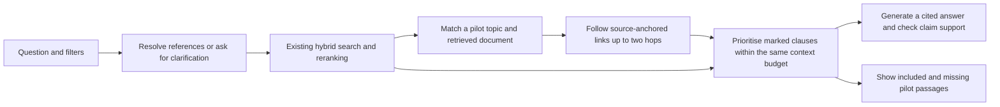

# Graph-assisted RAG pilot: OC 128 and OC 226

13 October 2026. Local development pilot; independent source and answer review pending.

## What this changes

Ordinary retrieval searches for passages similar to the question. It may retrieve the original circular, the addendum, or a relevant condition, without including all three. This pilot adds a small, explicit map of selected source passages and amendment relationships. It helps bring the change and its surrounding conditions into the answer context together.

The existing BM25, Chroma embeddings, local reranker, Qwen model and citation checks remain in use. No graph database, new embeddings, corpus migration or model upgrade is required. This is a focused graph-assisted extension, not the complete Microsoft GraphRAG pipeline.

| Pilot family | Linked documents | What the pilot tries to retain |
|---|---|---|
| UPI deemed debit | OC 128 and OC 128A | Original exclusions, changed response-code table, use-case exceptions, settlement, reconciliation, mandate validity and effective-date text |
| UPI biometric authentication | OC 226 and OC 226A | Original transaction limit, changed limit and effective date, continuing requirements, device checks, consent, PIN-reset handling, key rotation and inactivity |

These families are separate. A shared occurrence of “UPI” does not create an amendment link between them. Deemed approval under OC 39A is also a different subject.

## How it works



The graph manifest stores document IDs, page ownership, exact quoted locators, page hashes, topic membership and typed document relationships. Amendment links specify the affected aspect rather than declaring that the entire older document is superseded. Effective-date readings are recorded for review; this pilot does **not** implement an automatic temporal rule engine.

At startup, every anchor must match its source page hash and an existing chunk. A changed or unavailable source disables the overlay and leaves a warning. Standard retrieval remains available. This prevents an old graph from silently attaching to changed text after an import.

Expansion requires both a relevant topic/reference and a retrieved or explicitly resolved pilot document. It is bidirectional, cycle-safe and limited to two hops and 12 graph passages. Graph passages are prioritised before ordinary seeds; the total remains at most 18 passages and 18,000 budgeted characters. Deduplication preserves ordinary source citations. This can displace other useful evidence, so broader evaluation is necessary.

Explicit product, fiscal-year, feature and issue-date filters remain boundaries. Strict searches, selected-document requests and document summary/comparison routes retain their existing behaviour. Unknown issue dates are not silently filled from the graph. A date filter remains an issue-date filter, not a reconstruction of rules effective on that date.

“All marked pilot passages present” only describes this curated manifest. It does not mean every relevant circular has been found. Some OC 128 questions still omit a marked genuine-decline qualification because of the 12-passage graph cap; this is exposed as partial coverage.

## Measured evidence retrieval

Final retrieval capture: [paired experiment](../evaluation/graph_runs/20261013T172007163071Z/summary.md), with full responses and fingerprints in the adjacent `capture.json`.

Same corpus, hybrid retrieval, reranker, filters and context budget in both arms. The only retrieval intervention was the graph overlay. Arm order alternated between questions. The source snapshot and saved configuration remained unchanged.

| Measure | Existing hybrid flow | With graph pilot |
|---|---:|---:|
| Required passages retrieved | 33 / 39 | 39 / 39 |
| Substantive questions with every required passage | 7 / 12 | 12 / 12 |
| Routing and filter controls passed | 8 / 8 | 8 / 8 |
| Median retrieval time for substantive questions | 2.069 s | 2.154 s |
| Model fallback cases | 0 | 0 |

There are **20 cases: 12 substantive questions and eight controls**. The 12 questions require **39 passage anchors in total**, because one answer may need several passages. The controls exercise ambiguity, unavailable references, other products/topics, strict/selected routes and date filtering. They are not eight independently scored negative answers.

The questions and graph were co-designed with AI assistance. This is a development test, not a held-out benchmark. Passage coverage is not answer correctness, factuality or a RAGAS score. Single-run timings include cache/model warm-up and cannot establish a general latency advantage.

An earlier capture, `20261013T171800909070Z`, had the same retrieval counts but failed to record installed-model metadata. It is retained for audit and is not the primary reported run.

## Generated answers: evidence improvement is not enough

Six substantive questions were also run through the local Qwen 3.5 9B model and existing claim checks in both arms. [Saved generation comparison](../evaluation/graph_runs/20261013T172250968194Z/summary.md). All 12 requests completed without model fallback; source/configuration fingerprints remained unchanged.

| Observed result | Existing flow | Graph pilot |
|---|---:|---:|
| Required passages retrieved for these six questions | 15 / 19 | 19 / 19 |
| Draft responses | 5 | 4 |
| Incomplete responses after support checks | 1 | 2 |

These are response statuses, not correctness scores. Independent answer review remains pending. In particular:

- **BIO-04, historical date comparison:** both arms had the source effective date. The numeric support check rejected a claim containing “15 July” from the question, which was absent from the cited source text. The graph cannot repair this overly strict checking behaviour.
- **DD-01, original response-code exclusions:** the graph retrieved both fragments of OC 128's split table, but the generator cited only the fragment missing “59”. The support check withheld that claim. The baseline cited both fragments and returned a draft. Better retrieval alone does not guarantee correct citation selection.
- **DD-03, reconciliation:** the graph supplied the three-way reconciliation clause missing from baseline context. Its draft included that detail. However, it strengthened the source wording “are advised” to “must”; the automated check did not reject this change in wording strength. Treat this as an answer-quality finding for review, not a verified improvement in correctness.
- **DD-02, use-case comparison:** noisy OCR such as “1PO” was carried into generated wording. Linking sources does not correct extraction errors.

The pilot supports continuing graph-assisted retrieval research, but does not justify a claim of better end-to-end answer accuracy yet. Priorities before broad enablement are table-fragment citation grouping, supported date comparisons, preserving obligation strength, source correction and independent scoring on unseen questions. Keep graph expansion opt-in while these are addressed.

## Source checks and limits

An AI visual check of the saved OC 128A PDF (both pages) confirmed the response-code table layout, separate capital-market/other-OTM conditions and effective-date line. The saved OC 226A PDF was also visually inspected for the limit-change and continuing-requirements paragraphs. PDF hashes matched the indexed source records. This is not independent human verification.

OC 128's imported text has an incomplete sentence on page 2 and unverified issue-date metadata. The pilot does not repair or infer the missing words. Raw OCR text is unchanged, including noisy response-code spellings and table layout. Important conclusions require source review.

The graph covers only these four documents. OC 88, OC 206A and the RBI authentication reference within OC 226 are outside the pilot graph, although ordinary retrieval may independently find related evidence. No claim of complete legal history or current applicability is made. Expansion to RBI and other sources needs source-supported, reviewed links; issuer names do not determine precedence.

## Try it locally

Double-click `run-graph-pilot.cmd` in the project folder, keep its window open, and visit **http://127.0.0.1:8769** after startup. Ollama must be running for hybrid search and generated answers. The launcher copies your normal configuration into `tmp/graph-pilot-config.json`; it does not change `config.json`.

Use the **UPI** product filter and **Related** context. Try:

- “What is the UPI on-device biometric transaction limit, and when did it change?”
- “Does UPI OC 226A remove the device security validations and customer consent requirements?”
- “How did UPI deemed debit treatment for response codes 59 and K1 change from OC 128 to OC 128A?”
- “For UPI deemed debit, do VO and VH declines have the same treatment for MCC 6211 and other OTM use cases?”

Inspect the new **Graph pilot: linked circular evidence** panel and the original source passages. The ordinary launcher retains the existing flow. The pilot is opt-in and has not been enabled globally.

## Reproduce and review

From the project directory:

```powershell
.\.venv\Scripts\python.exe -X utf8 evaluation/graph_pilot_eval.py --method hybrid
.\.venv\Scripts\python.exe -X utf8 evaluation/graph_pilot_eval.py --method bm25 --no-rerank
.\.venv\Scripts\python.exe -X utf8 evaluation/graph_pilot_eval.py --method hybrid --mode generate --ids BIO-01,BIO-02,BIO-04,DD-01,DD-02,DD-03
.\.venv\Scripts\python.exe -X utf8 -m unittest discover -s tests -v
```

Each evaluation creates a timestamped directory under `evaluation/graph_runs/` with full paired responses, input/code/model fingerprints, metrics and a blank human-review sheet. The frozen original 50-question and mixed-source datasets are unchanged.

The [question and evidence catalogue](../evaluation/GRAPH_PILOT_CASEBOOK.md) explains all 20 pilot cases. The [visual source-check record](../evaluation/graph_source_review_20261013.json) records the two inspected amendment PDFs and their hashes.

Validation: **292 Python tests passed, zero skips/failures**, including 15 graph-specific checks. Both existing JavaScript test suites and the `web/app.js` syntax check passed. [Saved Python test record](../evaluation/validation_runs/20261013T172550528778Z/validation.json).

Reviewers should inspect original PDFs and score stale-rule use, incorrect entity/use-case scope, unsupported supersession and missing conditions. Blank review cells are pending work, not passes. Before widening the rollout, independently review these links, add unseen questions and longer chains, resolve source-quality gaps, and evaluate answer correctness as well as retrieval. A graph does not solve missing documents or unreliable extraction.

Implementation: `graph_context.py`, the small hook in `adaptive_context.py`, `pilot/upi_128_226_graph_v1.json`, `evaluation/graph_pilot_eval.py` and `tests/test_graph_context.py`. The explicit builder `tools/build_graph_pilot.py` is only for deliberate re-curation; do not regenerate hashes merely to silence a stale-source warning.
