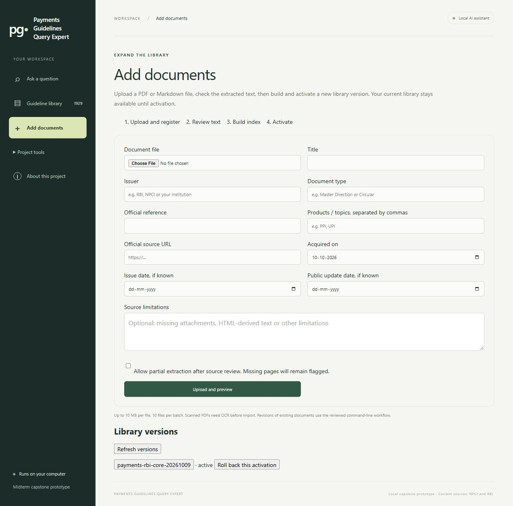

# Answer reliability, mixed-source evaluation and document import

Implemented on 10 October 2026 for Payments Guidelines Query Expert. The active local corpus remains `payments-rbi-core-20261009`: NPCI plus eight RBI direction snapshots. Generation remains Qwen 3.5 9B, embeddings Qwen3 0.6B, context 16,384 tokens and output ceiling 3,072 tokens. No larger model was installed and no Git push was performed.

## 1. Answer latency and review handling

Previously, generation and several separate review requests could each wait up to five minutes. The answer pipeline now shares a processing budget across model calls. The existing output and evidence limits are unchanged.

| Setting | Default | Purpose |
|---|---:|---|
| `answer_timeout_seconds` | 120 s | Remaining budget shared across answer processing |
| `generation_timeout_seconds` | 60 s | Draft-generation call |
| `embedding_timeout_seconds` | 20 s | Question-embedding call |
| `claim_support_timeout_seconds` | 12 s | Each claim-support call |
| `claim_review_budget_seconds` | 35 s | Cumulative claim-review time |
| `coverage_timeout_seconds` | 15 s | Scope/omission reviewer |

Budgets are request-local, not mutable engine-wide state. Before a model call, its allowed wait is capped by the remaining answer budget. This is a cooperative processing budget, not a hard real-time deadline: CPU retrieval, operating-system scheduling, socket behaviour and fallback can add time. Closing an HTTP request does not guarantee immediate cancellation of Ollama's internal work.

The frontend now starts `/api/answers`, polls `/api/jobs`, and displays the current stage and elapsed time. The existing synchronous `/api/answer` remains available. Each server permits one answer, review write or import job at a time. This does not coordinate separate evaluation processes or another server using the same Ollama instance.

If model processing fails or times out, the app returns keyword source excerpts without asserting an AI answer. A claim whose automated support check fails is withheld. A failed coverage review reports its failure separately; it is never treated as successful verification. Response timing and token counts are inspectable and included in exported notes. When only some claims survive checking, the answer is explicitly labelled Partial draft and reports the withheld count. Stage timing includes work until the next stage transition; model-call timings isolate the individual network calls.

Saved observations:

- Earlier integration request: 718.943 seconds, with unavailable coverage review; see [the integration record](RBI_CORE_INTEGRATION_20261009.md).
- New same-question observations: [27.266 seconds](../reports/latency/20261010T030848Z/result.json) and [16.016 seconds](../reports/latency/20261010T031256Z/result.json). Two claims passed automated support checks in each. These are developer observations with different load/cache conditions, not a controlled speedup claim.
- [Model-not-running recovery](../reports/latency/20261010T030817Z/result.json): 2.188 seconds to keyword excerpts. This is an outage test, not improved generation speed.

The reviewer diagnostic exposed a real failure: it sometimes labels a finding a conflict while citing only one passage. The app rejects that finding and marks the coverage review unavailable. Other reviews produced questionable conflict interpretations. Runtime recovery is implemented; reliable semantic review is **not solved**, and same-model checking is not independent verification.

## 2. RBI–NPCI evaluation

[The frozen 20-question catalogue](PAYMENTS_EVALUATION_20_CASES.md) includes exact source anchors, draft expected answers and failure modes. Its [JSON dataset](../evaluation/payments_cases_v1.json) and SHA-256 checksum are separate from the original 50-case UPI benchmark.

- 17 answerable questions and 3 unavailable-evidence questions.
- 34 required anchors, because one question can need several passages.
- Eight RBI direct cases, five RBI–NPCI cases, one RBI cross-document case, three scope/qualification cases and three unavailable-evidence cases.
- Development set; AI-assisted references; independent source and answer review pending. RBI page 1 is the logical HTML-derived text page, not a physical PDF page.

`evaluation/payments_eval.py` verifies anchor ownership against the active source text, runs hybrid retrieval with reranking, records each response and latency, fingerprints the dataset/configuration/code/models, checks source inputs at completion, and writes a human-review worksheet. The cases use the specific-question route; the runner does not silently force the UPI product filter. Explicit route/document/entity settings are also preserved in the existing RAGAS capture runner. Inference about authority or legal precedence is not part of the metric.

The first complete [retrieval run](../evaluation/payments_runs/20261010T031606Z/capture.json) found **18/34 anchors**, with **7/17 answerable cases finding all required anchors**. Evidence mode returned passages for all three negatives, so **0/3** had empty-evidence abstention. This is not a score for generated-answer correctness. That first run predates the runner's completion fingerprint check; use the later generation capture for RAGAS scoring.

The final [20-question generated-answer run](../evaluation/payments_runs/20261010T081610Z/capture.json) completed with an unchanged source/configuration/dataset snapshot. It found **18/34 anchors** and all required anchors for **7/17 answerable questions**. The generator abstained on **3/3 negatives**, and also on **7/17 positives**. Ten positives displayed at least one checked claim, which does not establish that their answers were complete or correct. Median request latency was **24.0545 seconds** and maximum **65.187 seconds**, including two zero-model retrieval exits. Five generated responses had an unavailable coverage review. This run retained those failures. The subsequent Partial draft banner change affects presentation only; the saved response text is preserved as captured.

The [20-answer human review worksheet](../evaluation/payments_runs/20261010T081610Z/human_review.csv) is ready for colleagues. All human verdict fields are deliberately blank. The [run index](../evaluation/payments_runs/README.md) identifies the final capture, earlier pilots and an interrupted contention run.

The [five-question generated-answer pilot](../evaluation/payments_runs/20261010T032145Z/capture.json) completed with an unchanged snapshot: two answerable questions abstained, two displayed claims, and the one negative abstained. A completed application response is not necessarily a correct answer. Its [RAGAS results](../evaluation/payments_runs/20261010T032145Z/scores-20261010T081313Z/SUMMARY.md) report:

| Metric | Successful mean | Scored | Errors | Skipped | Cases |
|---|---:|---:|---:|---:|---:|
| Faithfulness | 1.000 | 1 | 1 | 3 | 5 |
| Context recall | 0.833 | 3 | 0 | 2 | 5 |

One faithfulness metric timed out. Some scoring overlapped other local model requests, so its timing is not a controlled latency measurement. The successful faithfulness score refers to one response only; it cannot support a claim of 100% system accuracy. Context recall is the judge's comparison against draft-reference claims, whereas anchor recall checks exact excerpts. The judge and generator use the same model. Human review remains necessary.

Observed retrieval issues include inferred product filters excluding the explicitly named circular (for example FASTag causing an NETC filter on the UPI OC 207 question), named-circular candidate restriction missing the RBI passage, and missing qualifications in long directions. Generation may also omit the central answer while retaining a tangential supported claim. These findings are retained for the next improvement cycle, not hidden by changing the test questions.

Reproduce with the environments already configured on this machine:

```powershell
.venv\Scripts\python.exe evaluation/payments_eval.py
.venv\Scripts\python.exe evaluation/payments_eval.py --mode generate
.venv-eval\Scripts\python.exe evaluation/ragas_runner.py score evaluation/payments_runs/<run>/capture.json --metrics faithfulness,context_recall --timeout 60 --max-tokens 2048
```

Run these sequentially, without simultaneous app model requests. Each run gets a timestamped folder. Interrupted captures remain marked running and cannot be scored; start a new run rather than presenting them as completed. In `human_review.csv`, reviewers must verify the original source, correct the reference where necessary, assess answer correctness/completeness and citation support, and record their identity and comments. Review decisions must not be inferred from automated scores.

## 3. Add documents in the browser

**Add documents → upload/register → inspect preview → prepare → build → confirm activation.**

The screen wraps the existing CLI pipeline instead of creating a second ingestion format. It preserves source bytes, metadata, canonical ownership, extraction gaps, clause chunking, embedding cache and Chroma/SQLite validation. An upload does not automatically join the active corpus.

New Markdown and text-readable PDF sources are supported. The limit is 10 MB per file, 500 PDF pages and 10 files per batch. File paths supplied by a browser are not used as destination paths. PDF page count is checked before text extraction. Preview shows at most three pages, so it does not replace full-source review. Duplicate identity, source URL or content is flagged; snapshot replacements use the reviewed CLI workflow. Scans need OCR first. Thin extraction is quarantined unless partial extraction is explicitly accepted.

Build runs in a background local process with progress and a 30-minute timeout. A failed build leaves the active corpus unchanged. Completed vectors can be reused on retry. Activation validates unchanged source/configuration inputs before switching the configuration and running engine. Rollback restores the previous configuration and engine; versions are retained. Rollback controls are shown only for the currently eligible activation. Upload selections and job history are process-local; prepared releases are persistent.

The local endpoints require a loopback Host; writes require JSON and reject cross-origin requests. There is no remote deployment, login system, website crawler or source scheduler. Source URLs are provenance, not automatic fetch instructions.

See [the step-by-step guide](ADDING_DOCUMENTS_QUICKSTART.md) and [pipeline details](DOCUMENT_INTAKE.md).



## Validation and boundaries

The final regression run discovered 255 Python tests: 251 passed and four optional HTML-conversion tests skipped because the application environment lacks optional lxml. Both JavaScript renderer suites passed, including review-failure escaping and export; the new browser scripts passed syntax checks. These are implementation checks, not independently reviewed answer-quality scores.

The isolated browser journey uploaded synthetic Markdown, inspected extraction, prepared and built one real Chroma embedding, activated the candidate, retrieved its source text, then rolled back to the empty baseline. Slow embedding access also exercised the real keyword fallback. The synthetic document never entered the active NPCI–RBI library. The inline confirmation replaced a native dialog that was unreliable in the embedded browser. The retained history showed `rolled_back` after restoration.

Remaining work is explicit: independently review the new references and answers, correct cross-source retrieval failures, calibrate/reconsider automated coverage checking, and evaluate model alternatives only after these findings are addressed. No claim of bug-free software or regulatory correctness is made.
