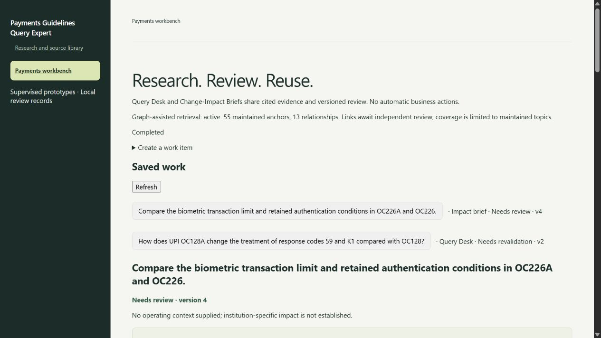

# Two supervised payments workflows

Updated 22 October 2026.

Current follow-up work and owners: [active action register](ACTION_ITEMS_20261022.md). [Readiness diagnostics](../evaluation/readiness_diagnostics/README.md) document the later timeout repeats, narrow citation-label repair and rejected generation-prompt experiment. Earlier failures below are retained as historical evidence.

The local app now has **Payments Query Desk** and **Change-Impact Briefs** at `/work`. These are reviewable prototypes built on the existing payments RAG engine. They do not send replies, approve compliance decisions or deploy transaction rules. Independent acceptance and final release verification remain gates.

## Query Desk

Create a question with optional product, issue-date cutoff and selected documents. Generate a cited draft, inspect the retrieved excerpts and original-source link, revise the wording, and submit the version for review. A reviewer records a name, rationale and checks of original sources and material qualifications before approving it. Export includes evidence and review status, including when the answer is still a draft.

Clarifying the question or product creates a fresh request version. A different document selection can be made by creating another item. Earlier answers remain in version history. Unknown citation labels and uncited answer edits cannot be submitted. Citation presence alone does not prove support.

## Change-Impact Briefs

Select the proposed changed document first and at least one earlier source, up to six documents. The existing comparison route generates cited findings about the change, retained conditions and uncertainties. Selection order does not establish legal precedence.

The document findings, analyst-proposed actions and unresolved questions are separate fields. The initial team checklist is a generic review aid for product/operations, compliance, support and transaction-risk owners; it is **not a model-inferred impact assessment**. Analysts can edit it after inspecting the sources. Supplied operating context is preserved for the reviewer; the implementation does not infer internal deployment state or automatically assess that context. Without institution-specific evidence, the brief remains generic.

## Review and versioning

`Draft → Needs review → Approved`, with `Rejected` and `Needs revalidation`.

- Generation and editing create immutable draft versions.
- Editing an approved answer starts a new draft; its earlier approval remains only in history.
- Source/corpus or model/graph configuration changes invalidate reuse of a saved answer. The current check is conservative: a corpus change can invalidate an item even if its cited pages are unchanged.
- A rejected item must be edited or regenerated and resubmitted before approval.
- Revision checks prevent stale edits from overwriting someone else's changes. Generation is serialized with other app jobs.
- An interrupted generation leaves earlier versions intact and records the interruption on restart.
- Local reviewer names provide attribution, not authentication. Run one app process against a workflow database; this is not a multi-user production service.

Records live in `data/workflows.sqlite3`, separate from corpus metadata, source annotations and the earlier orchestration application. Each version stores the request, answer, exact evidence, automated warnings and a corpus/source/configuration/graph snapshot. Workflow snapshots retain installed generation/embedding digests from local Ollama as well as model names and budgets. Browsing caches metadata for up to 30 seconds; approval and export force a fresh check. Missing metadata blocks approval. Earlier development drafts without model digests require regeneration. This is software provenance, not independent attestation of model behaviour.

The APIs are `/api/work-items`, `/api/work-item`, `/api/work-create`, `/api/work-generate`, `/api/work-edit`, `/api/work-review` and `/api/work-export`. Generation uses the existing asynchronous job endpoint. Local-host, same-origin and JSON request checks apply. No public deployment is introduced.

## Graph decision

**Retain maintained graph-assisted retrieval. Automatic whole-corpus graph expansion is not selected for this release.** The relationship inventory remains available for inspection and future curation.

The maintained manifest covers six UPI topic groups, 55 quoted anchors and 13 proposed relationships. All 13 links still await independent review. Documents without links remain searchable. Product/date boundaries, strict selected-document routes, bounded traversal and ordinary-retrieval fallback remain in force. Summaries and selected comparisons bypass graph expansion; their quality cannot be credited to the graph.

Numbering families, explicit references, shared topics and aspect amendments remain different concepts. None alone establishes supersession. The earlier 40-case result (69/78 → 78/78 anchors) is development evidence. The 144-case quality comparison (220/234 → 223/234) had the graph on in both arms and is **not** graph-effect evidence.

New intake candidates copy the maintained manifest into the source release, include it in content hashes and validate it against that release. A stale or invalid anchor produces **degraded** graph status in validation and the app; ordinary retrieval remains available. A source change does not silently re-approve links.

Rollback uses the existing intake rollback to restore the matching configuration and source release. To disable maintained assistance for a demonstrated graph defect, preserve the current configuration, remove `evidence_graph_path` from a reviewed replacement configuration, restart, and confirm disabled status plus ordinary retrieval. Do not activate broader expansion as a substitute. Historical experiment scripts and reports remain unchanged.

## Current graph comparison

The [saved 144-case ablation](../evaluation/maintained_graph_runs/20261020T175334016268Z/capture.json) held the corpus, models and retrieval settings constant and alternated arm order. Maintained graph on: **223/234** expected anchors; off: **212/234**. Eleven gains across nine questions, no anchor losses and no execution errors. The graph was active on 40 questions, not applicable on 47, and bypassed/not invoked on 57. Routes without graph expansion are reported separately. The 24 cases without reference anchors include routing and unanswerable controls; they are not all expected abstentions. Their observed routes/source counts were unchanged.

Median warm retrieval latency was 1.359 seconds on versus 1.328 off; p95 was 1.938 versus 1.953 seconds. These are retrieval-only timings, not generated-answer SLA results or a claim of significant speed improvement. The first pair is excluded from warm timing. Capture fingerprints were unchanged during the run. Later workflow-only model fingerprint checks do not change the retrieval code evaluated here.

Independent graph-relevant paired answer review is still pending. Retain graph assistance for local development; do not infer release approval from anchor recovery.

The [six-attempt development answer run](../evaluation/workbench_20261020/paired_answer_findings.json) completed on 22 October with three model timeouts. Its remaining answers were incomplete; the IPO graph-on answer retained specific source history but still withheld two claims. This run cannot establish independent answer correctness, a clean critical-regression gate or generation latency. Exceptional wall-clock delays are retained for investigation, not attributed to the graph without evidence. The paired capture runner now returns a failing exit status when model fallbacks occur.

A [matching source/graph snapshot](../evaluation/workbench_20261020/source-graph-snapshot/README.md) preserves the manifest and release hashes, without claiming a release-approved corpus package.

## Quality findings and changes

Withheld claims now mark a surviving draft as incomplete even if its designated primary statement survived. Advisory completeness findings also make a draft visibly potentially incomplete without rewriting accepted wording. An unavailable completeness review remains a separate state, not a successful check or proof of an omission. All-withheld answers are explicitly abstained.

The [eleven-miss analysis](../evaluation/workbench_20261020/retrieval_misses.md) found five expected passages absent from the initial candidate pool and six lost in ranking/context selection. All quotes are present in the source text. Ranking changes and source corrections are not justified merely by this count; first verify which references are essential.

The existing bounded repair path and source-specific attribution checks remain in use. They do not reliably recover every qualification or historical fact. The browser Query Desk example for OC128/128A retained K1 while withholding the response-code 59 statement; its raw result and warnings remain a failure record, not an approved response. Same-model review can also flag incorrect conflicts. This prevents a claim that all foundation quality gaps have been closed.

## Independent acceptance

[The frozen provisional pack](../evaluation/pilot_acceptance_20261020/README.md) contains 20 Query Desk questions, 10 briefs and 20 negative/ambiguous/insufficient-evidence controls, including legitimate short and misspelled controls. It also contains all 55 graph anchors and 13 relationships for review. It has no independent expected answers yet and has not been scored.

Create a **new version** after a payments colleague checks originals, writes expected outcomes and essential qualifications, resolves disagreements and signs the graph review sheets. Do not overwrite the frozen candidate. Each reviewed case needs `review_status: independently_reviewed`, `reviewer`, `originals_verified: true`, `expected_outcome`, an `essential_qualifications` list and a `references` list of document/page/exact-quote anchors. Update its dataset hash; the manifest's review gate and scoring permission may change only after that review.

`evaluation/workbench_acceptance.py --pack <reviewed-folder>` checks the review gate without calling a model. Add `--capture --out <new-folder>` only for a reviewed pack on its matching source/graph release. Captures use a separate workflow database. Human scoring is still required; the runner does not convert retrieval matches into answer accuracy.

Proposed supervised-pilot gates: zero critical errors; at least 27/30 materially complete correct answerable cases; all 20 reviewed control behaviours; valid citation IDs and at least 95% supporting citations across assessed claims. Measure warm p95 separately against 45 seconds for Query Desk and 90 seconds for briefs; keep cold starts, model failures and GPU contention separate. These are targets, not achieved metrics.

## Handoff and remaining gates

The new work is local and has not been pushed to GitHub. The 10 October colleague package remains historical; it is not this workbench release.

1. Complete independent source/reference and graph review.
2. Run paired graph-relevant answers using those reviewed cases; investigate any critical regression before releasing graph assistance.
3. Correct demonstrated eligibility, attribution and completeness failures using reviewed evidence; rerun targeted development checks.
4. Capture and independently score the reviewed 50-case workflow benchmark, including latency.
5. Last, perform final clean-install/full-index-rebuild, browser, outage, interrupted-work, intake, graph-degradation and rollback verification; then freeze the new colleague handoff.

The state machine, software tests and browser journeys establish engineering progress. They do not replace those quality or release gates.

## Verification record

[Development verification and browser records](../evaluation/workbench_20261020/README.md) include 430 passing Python tests, four JavaScript suites, HTTP workflow tests, the graph ablation, remaining-miss classification, raw model failures and exported draft evidence. The impact brief browser journey reached Needs review after generation, source checks, an analyst edit, versioning and export. No real-source answer was marked Approved by the agent.

