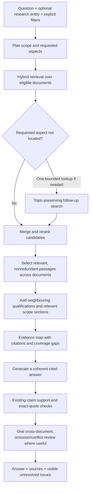

# Topic research across payment sources

Updated 9 October 2026. Implemented in `research.py`, the adaptive retrieval flow, answer generation and the browser's scope/coverage view. The active collection remains NPCI-only. Mixed-publisher behaviour is tested with synthetic fixtures; real RBI acquisition and cross-source answer evaluation remain pending.

## Intended behaviour

For a topic covered by several documents, assemble a coherent answer while preserving each source's ownership, applicability, qualifications and dates. Publishers do not have dedicated search branches or mandatory quotas. A newly ingested regulator, payment network or institution can participate through ordinary document metadata and retrieval.



## Scope and routing

- The optional **Researching for** field gives the model a user/entity context. It accepts free text. Suggestions and automatic entity-name recognition come from corpus applicability labels, not a fixed list of publishers or bank types.
- Unknown or absent applicability metadata stays eligible. Entity tags provide a small ranking hint and generation context; they do not decide legal applicability or hard-exclude sources.
- Product names inferred from a broad question no longer silently become hard filters. A cross-product framework can therefore be retrieved alongside a product circular.
- Explicit Product, issue-date cutoff, fiscal-year, feature and selected-document constraints remain boundaries. Circular-number lookup still uses product inference to help resolve references safely. Ambiguous references still require disambiguation.
- An automatic overview/summary request without named documents becomes topic research. Explicit document summaries and comparisons retain their document-coverage routes. A comparison still requires identified documents; this version does not automatically decide which documents form the requested comparison.

## Retrieval and useful diversity

Topic/clause research retrieves up to 64 candidates. If the question requests multiple recognised aspects and one is not found among the initial leading passages, a single topic-preserving follow-up retrieves up to 16 additional candidates. The union is capped at 80 for reranking. Simple questions do not automatically gain a planning model call or extra searches.

Selection combines rank, overlap with already selected passages, document novelty, requested-aspect novelty and a small provenance-diversity preference. Provenance is the recorded issuer or, if absent, the source URL's hostname. It is not an authority hierarchy. There is no RBI/NPCI split and no requirement to include every publisher.

Six direct passages are selected, normally at most three per document; explicit single-document research permits more. Near-identical passages are skipped. When cross-encoder scores are available, a relative score window avoids adding very low-ranked material solely for diversity. The weights, duplicate threshold and score window are heuristics requiring tuning, not calibrated relevance probabilities.

Within selected documents, up to six qualification passages can be added: adjacent chunks across relevant section boundaries, applicability/definition sections, and topic-matching conditions, dates or exceptions. Existing one-hop reviewed/recorded references and related-feature expansion remain bounded. The character/passage budget still applies and omitted evidence is reported. This does not guarantee that a distant annexure or an unrecorded amendment will be found.

## Evidence map and answer checks

The evidence map records citation, document, provenance group, type, page/section, dates, extraction-review status and matched aspects. Generic English patterns identify requirements, applicability, definitions, exceptions, limits, timing and changes. A label such as **Passages found** means only that a heuristic matched included text; it is not an answer-completeness score.

Generation receives the question scope, a compact aspect map and the actual passages. Instructions require source attribution, coherent prose, preservation of qualifications and explicit uncertainty. Neither a newer date nor publisher identity establishes precedence. Documents and their metadata remain untrusted model inputs.

Existing per-claim support checks continue. A further **single model call** reviews material omissions, conflicting qualifications or unclear scope when multiple documents or multiple requested aspects are involved. The application splits supplied passages into contiguous excerpts of at most 700 characters and assigns immutable IDs. The reviewer selects IDs; the application attaches the original text, preventing invented quotations. A possible conflict needs excerpts from at least two passages. Unknown IDs, malformed results and unavailable models are reported as review unavailable. Valid excerpts do not prove that the reviewer's interpretation is correct. Findings are displayed separately from the answer and included in Markdown export.

No finding means **No additional issue flagged**, not “complete” or “correct”. This is a same-model check and can miss errors. It does not automatically rewrite the answer, resolve legal conflicts or search the open web. The extra review can increase answer latency; it is skipped for simple single-document/single-aspect answers, evidence-only requests and abstentions.

## Adding applicability metadata

The intake manifest accepts an optional field:

```json
"applicability": {
  "entities": ["commercial banks"],
  "page": 2,
  "quote": "Exact text copied from page 2 of the acquired document."
}
```

The pipeline checks that the quote occurs on that extracted page. It stores the classification as operator-supplied and not independently verified. A matching quote does not validate the interpretation or establish that all of a document applies to that entity. Existing corpus entries do not have to be retagged or re-embedded to use the new retrieval flow.

## Evaluation and controls

`research_enabled` defaults to true for the multi-product adaptive flow. Set it to false in an isolated comparison config to reproduce the previous selection policy. `coverage_check_enabled` defaults to true and can disable only the additional omission review. Neither switch changes stored vectors or embedding inputs.

Run regression tests with `run.cmd test`. Run the frozen-set comparison with:

```powershell
.\.venv\Scripts\python.exe evaluation\research_comparison.py
```

The comparison verifies the frozen dataset checksum, respects each case's product/scope/date settings, warms both variants, alternates execution order and records configuration, code hashes, corpus fingerprints, embedding digest and source passages. It measures evidence retrieval only; summary/comparison routes bypass candidate reranking and are reported separately by route.

The 9 October comparison (`reports/research-comparison/20261009T143535Z/results.json`) found 55/55 expected anchors and 5/6 empty-evidence negatives in both variants, with no request errors. Median retrieval latency was 167.26 ms for the previous policy and 173.80 ms for the new policy in one run. This is the existing AI-assisted UPI-focused set, awaiting independent review. It does not establish improvement on real mixed-authority questions. One negative case still retrieves passages and needs further investigation.

The earlier exploratory run at `20261009T143301Z` did not preserve per-case product/scope/date settings and is **not the valid benchmark comparison**. It is retained as a debugging record rather than used for quality claims.

Next evaluation should use independently reviewed mixed-source questions with required evidence, entity qualifications, exceptions, conflicting/dated provisions and unanswerable cases. Compare omission rate, supported-claim quality and complete application latency; do not optimise the number of publishers cited as a success metric.

## Live validation and token settings

See [9 October validation](TOPIC_RESEARCH_VALIDATION_20261009.md) for retained failures as well as passing checks. The local model still made participant-attribution mistakes, and the same-model reviewer raised a false conflict between different responsibilities. Overall answer improvement is not yet demonstrated.

Keep the current 16,384-token model context and 3,072-token output cap while evaluating quality. Context capacity must accommodate instructions, evidence, question and generation; it is not an evidence-retrieval target. The separate 18,000-character evidence budget controls what is actually supplied. Raising the model context alone does not retrieve more documents. Raising output limits helps truncated answers, not incorrect attribution. One measured generation used 6,189 prompt tokens and 155 output tokens and ended normally. Any larger context or output experiment should measure full-answer latency, memory use, omissions and supported claims on the same cases.
