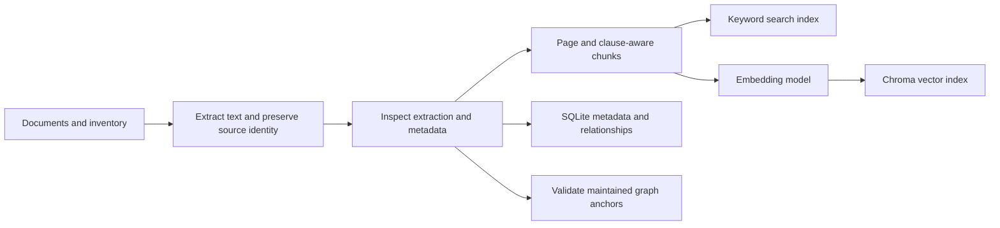
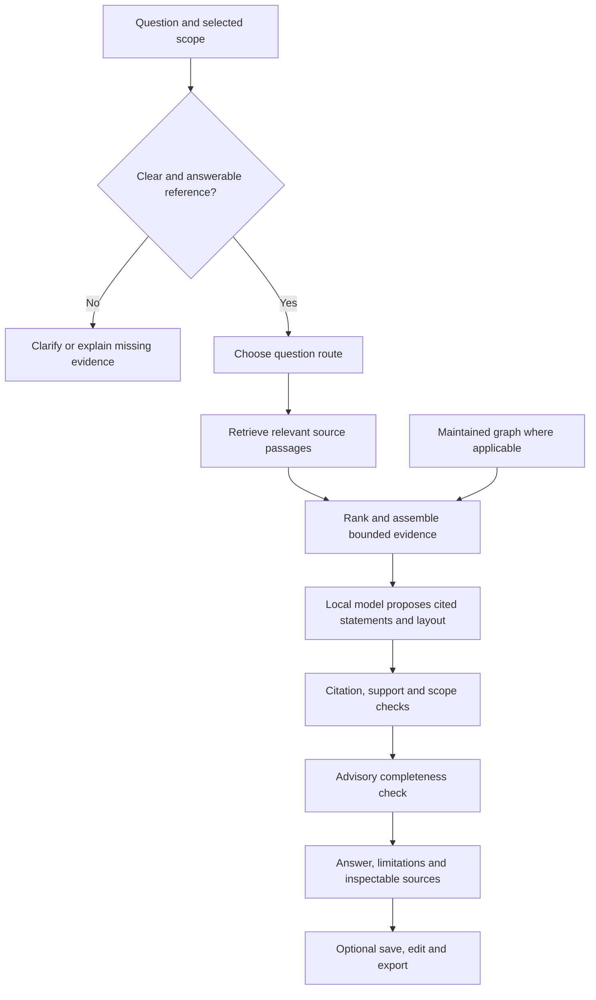

# The project flow, explained

Start from [the team guide](../../TEAM_START_HERE.md). This page describes the current implementation, not every historical experiment in the repository.

## The problem and the product

A payments question can depend on several documents: an introductory circular, a later amendment, a general provision and a regulator's direction. Searching only one document can produce a plausible but incomplete answer. Our assistant helps find and explain the evidence while keeping document identity visible.

It uses pretrained models. We do not fine-tune Qwen on the circulars. The documents remain in a separate library that can be updated, cited and inspected. This is the reason for using retrieval-augmented generation, or RAG.

## Flow A: prepare the library

1. **Register the document.** Keep its identifier, product memberships, issuer, dates, source link and availability. An unavailable circular can remain in the inventory without pretending its text was read.
2. **Extract or import text.** Much of the existing library is Markdown converted from PDFs. Markdown can still contain OCR mistakes; conversion does not prove accuracy. RBI HTML snapshots use logical text pages rather than physical PDF pages.
3. **Chunk the text.** The active clause-aware chunker respects document/page ownership and recognisable sections or clauses. It aims to retrieve focused passages rather than whole documents. It does not combine unrelated circulars into one ownerless passage. Large or poorly extracted sections can still lose useful structure.
4. **Build search structures.** BM25 indexes words; the embedding model produces semantic vectors stored in Chroma. SQLite stores metadata and relationships. These solve different problems.
5. **Validate and activate.** New intake is prepared separately, checked and activated explicitly. Content hashes support traceability and reuse of embeddings for unchanged text. Changed source text can invalidate graph anchors and saved approvals.

The GitHub handoff already packages the source text and metadata. A teammate restores those files, then builds their own vector index. Normal use does not retrain the language model or rebuild the whole library for each question.

## Flow B: answer a question

**Understand the request.** The system considers the product, exact circular references, selected documents and issue-date cutoff. Ambiguous references may need clarification. An issue date is not necessarily the effective date of a rule.

**Retrieve.** Keyword search helps with precise terms and circular numbers. Vector search helps with different wording. Hybrid retrieval combines them. Exact-document summaries and comparisons have document-oriented routes; not every request follows the same reranking path.

**Rank and assemble.** A local CPU reranker orders candidates for applicable routes. Neighbouring or related passages can supply conditions missed by an isolated chunk. Evidence is bounded by passage and context budgets, so some material can still be omitted.

**Use graph assistance selectively.** The maintained graph has source-anchored links for a limited set of UPI topics. Traversal is bounded to two hops and at most 12 graph chunks, with scope controls. All other eligible documents remain searchable. A shared topic, suffix or newer date does not prove that one rule supersedes another. Automatically expanding the whole-corpus graph was not selected for this release.

**Generate and check.** Qwen receives the question and evidence and proposes cited statements. The existing checks can withhold unsupported claims or attempt a bounded repair using available evidence. A separate completeness check looks for some omissions; it can fail, time out or return invalid output. It is advisory and not independent expert verification.

**Present.** Automatic style can arrange retained statements as paragraphs, lists or tables. Table cells retain citations; malformed layouts fall back to readable text. If a cell is withheld, the table falls back rather than shifting other statements into its column. Formatting does not add evidence or establish correctness.

## Why these modules exist

| Module | Problem it addresses | Remaining trade-off |
|---|---|---|
| Inventory and extraction | Know which document was read and what is missing | Metadata and OCR can be wrong |
| Chunking | Find focused evidence | A small passage can omit a condition |
| BM25 | Match exact terminology | Can miss paraphrases |
| Embeddings and Chroma | Find related meaning | Similar text may be irrelevant |
| Hybrid retrieval and reranking | Improve candidate selection | More computation; benefit needs measurement |
| Maintained graph | Recover known related provisions | Limited coverage; links need independent review |
| Bounded context | Fit useful evidence into model limits | Relevant evidence can be left out |
| Language model | Explain evidence in relation to the question | Can misinterpret or overgeneralise |
| Checks and source reader | Expose some unsupported claims and let users inspect evidence | Passing checks does not certify an answer |
| Saved workflows | Preserve questions, evidence, edits and decisions | Local attribution is not enterprise authentication |

## What is enabled, and what is experimental?

The shared engine uses the maintained graph with the current handoff configuration. Whole-corpus automatic graph expansion is not selected. Context-enriched BM25 and structured-evidence-before-synthesis experiments are not enabled by default. Their code and results remain for reproducibility, not as proof that they improved the deployed flow.

The UPI Lite investigation found that candidate retrieval had located an amendment, but final context assembly retained its historical preface and dropped its operative clause. Broad explanations now recover at most two matching amendment provisions from already retrieved candidates, within existing budgets and filters. Historical/exact-document routes bypass this addition. This does not infer supersession or guarantee that the model explains the evidence correctly. See [current verification](../PRODUCT_MATURITY_20261028.md).

## How the two tasks use this flow

Asking a question runs the flow above. Saving its result copies the completed answer, evidence and settings snapshot; it does not call a more accurate second model.

Understanding a change starts with source selection. The user confirms the revised document and comparison baseline. The shared engine uses its document-comparison route and is instructed to separate earlier/revised provisions, source-backed conditions, dates and unresolved points. Absence from a newer document is not proof of retention or withdrawal. Internal notes are optional human input, not automatically generated departmental obligations.

Both results can be saved, inspected and exported. Human sign-off records a person's local decision. It is separate from automatic checks and the independently reviewed acceptance benchmark. Existing source-change invalidation and version history remain in place.
